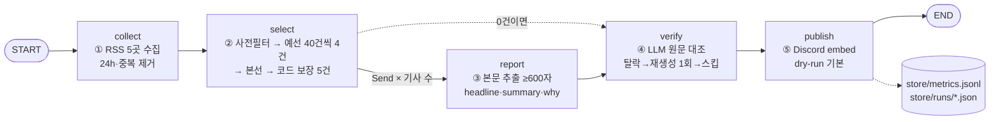
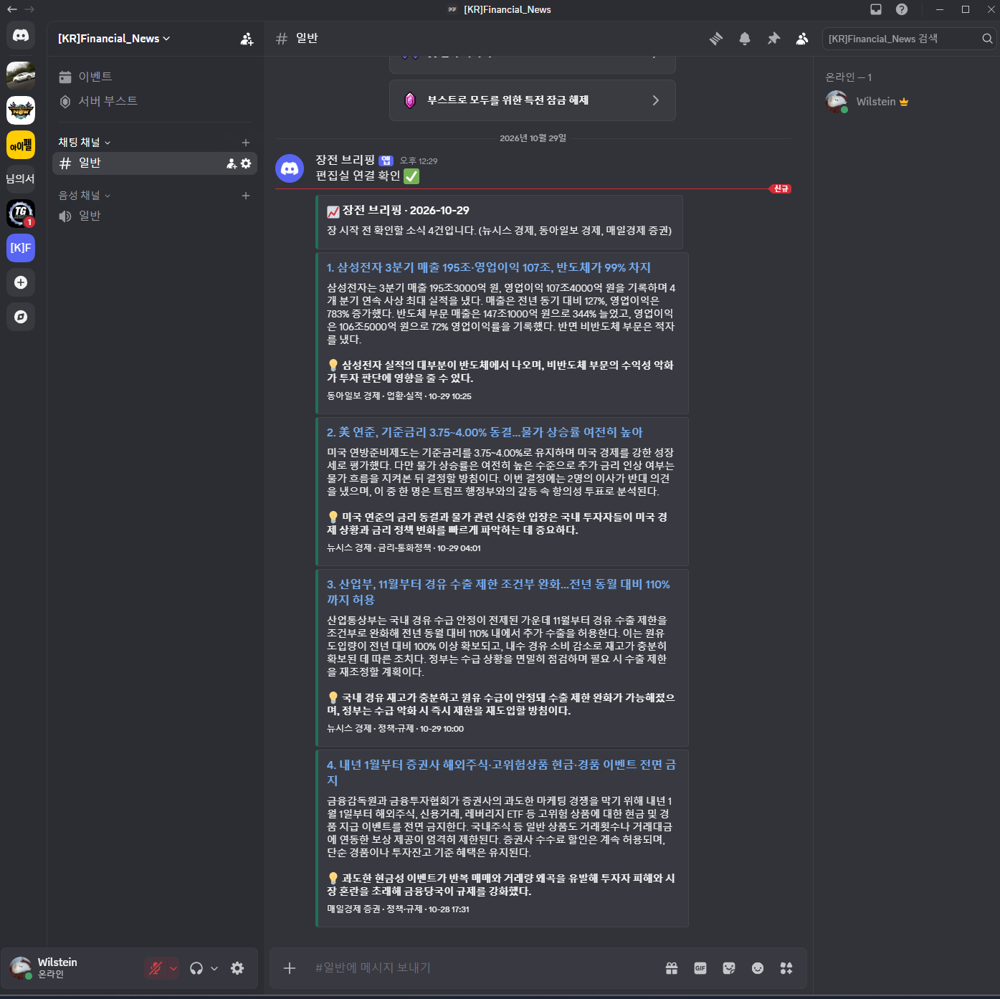

# 장전 브리핑 — 국내 증시·경제 뉴스레터 에이전트

작성: Sung, Hyun-Joon · 아이펠 AI Agent 2기 · 에이전트 팀 꾸리기 3 [프로젝트]

> 매일 평일 07:30(KST), 경제 매체 5곳에서 최근 24시간 기사를 모아 개인 투자자에게 중요한 5건을 고르고,
> 본문을 읽어 요약·인사이트를 쓴 뒤 원문 대조 검수를 통과한 것만 Discord로 발행한다.

| 실행 | 명령 |
|---|---|
| 소스 측정(채택할 때만) | `python audit_sources.py` |
| 시험 실행(보내지 않음) | `python run.py --dry-run` |
| 실제 발행 | `python run.py` (`.env`의 `DRY_RUN=0`) |
| 검수 고장 여부 시험 | `python check_verifier.py` |
| 자동 실행 | `.github/workflows/daily.yml` — 평일 07:30 KST + 수동 실행 버튼 |

---

## 1. 분야 및 독자 정의

**분야: 국내 증시·경제.** 경제 뉴스는 하루 수백 건이 쏟아지지만, 개인 투자자가 장 시작 전에 알아야 할 것은 그중 몇 건뿐이다. 반대로 시황 기사·목표주가 기사·홍보성 기사가 대부분이라 "골라 주는 일"의 가치가 크다. 또 기사마다 숫자(금리·환율·수익률)가 많아 **환각 검수의 효과를 숫자로 확인하기 좋은 분야**다.

**타깃 독자 페르소나** (`audience.yaml`의 `persona`)

| 항목 | 내용 |
|---|---|
| 누구 | 국내 주식(코스피·코스닥)에 직접 투자하는 3~5년 차 직장인 개인 투자자 |
| 언제·어디서 | 출근길 07:30~08:30, 휴대전화로 10분 |
| 읽고 나서 할 일 | 장 시작(09:00) 전에 오늘 시장과 보유 종목에 영향을 줄 소식을 파악 |
| 관심 없는 것 | 개별 종목 단순 시황, 목표주가 전달, 행사·MOU·인사, 결정 안 된 계획 |

인사이트 규칙: 영향을 받을 업종·지표를 짚고 "오늘 확인해 볼 포인트"로 끝낸다. **특정 종목 매수·매도 권유나 주가 예측은 쓰지 않는다**(투자 자문이 아니라 정보 정리).

---

## 2. 소스 채택표

측정 도구: `audit_sources.py` (원본 결과 `store/source_audit.md`, `store/source_audit.json`) · 측정 2026-10-29 11:53 KST
강의 제외 목록(OpenAI·DeepMind·TechCrunch·The Verge·MIT TR·AI타임스)은 후보에서 뺐다.

**채택 기준 두 단계**
1. **관문** — 하나라도 못 넘으면 탈락
   - G1 본문: 최근 기사 3건 원문에서 trafilatura로 뽑은 본문이 600자 이상인 비율 ≥ 2/3
   - G2 생존: 최근 24시간 글 ≥ 3건 (1차 소스는 ≥ 1건)
   - G3 수집 허용: 피드 응답 200, robots.txt가 수집을 막지 않음
   - 중복: 이미 통과한 소스와 24시간 기사 제목이 50% 넘게 겹치면 탈락
2. **등급 평가** — 관문 통과 소스끼리
   - 관련도: 24시간 기사 제목 중 증시·거시 키워드(코스피·금리·환율·외국인·실적 등 25개)가 들어간 비율
   - **매체당 피드 1개**, 관련도 상위 5곳 채택, 나머지는 '예비'

| 소스 | 구분 | 응답 | 24h 글 | 본문 추출(자, 3건) | G1 | robots | 중복 | 관련도 | 판정 | 근거 |
|---|---|---|---|---|---|---|---|---|---|---|
| 한국은행 보도자료 | 1차 | 200 | 1 | 105/6391/433 | 33% | 금지 | 0% | 0% | **탈락** | G1 본문 33% · G3 robots.txt 금지 |
| 금융위원회 보도자료 | 1차 | 503 | - | - | - | - | - | - | **탈락** | G3 피드 응답 503 |
| 정책브리핑 보도자료 | 1차 | 404 | - | - | - | - | - | - | **탈락** | G3 피드 응답 404 |
| 연합뉴스 마켓 | 2차 | 200 | 120 | 1030/2288/1877 | 100% | 허용 | 27% | 49% | **채택** | 관문 통과 · 관련도 49% |
| 한국경제 증권 | 2차 | 200 | 50 | 1245/1118/1667 | 100% | 허용 | 2% | 50% | **채택** | 관문 통과 · 관련도 50% |
| 매일경제 증권 | 2차 | 200 | 50 | 1088/939/907 | 100% | 허용 | 0% | 40% | **채택** | 관문 통과 · 관련도 40% |
| 뉴시스 경제 | 2차 | 200 | 100 | 1671/1429/1477 | 100% | 허용 | 0% | 42% | **채택** | 관문 통과 · 관련도 42% |
| 동아일보 경제 | 2차 | 200 | 50 | 989/834/1016 | 100% | 허용 | 2% | 28% | **채택** | 관문 통과 · 관련도 28% |
| 연합뉴스 경제 | 2차 | 200 | 120 | 2593/1030/2163 | 100% | 허용 | 0% | 27% | 예비 | 같은 매체 '마켓' 피드가 관련도 더 높음 |
| 한국경제 경제 | 2차 | 200 | 50 | 21701/601/553 | 67% | 허용 | 2% | 32% | 예비 | 같은 매체 '증권' 피드가 관련도 더 높음 |
| 매일경제 경제 | 2차 | 200 | 36 | 7987/7601/4464 | 100% | 허용 | 6% | 28% | 예비 | 같은 매체 '증권' 피드가 관련도 더 높음 |
| 경향신문 경제 | 2차 | 200 | 50 | 1163/1175/1055 | 100% | 허용 | 0% | 24% | 예비 | 관련도 24% — 상위 5곳 밖 |
| 머니투데이 | 2차 | 200 | 100 | 228/1555/1139 | 67% | 허용 | 0% | 10% | 예비 | 관련도 10% (전체 섹션 피드) |
| 조선비즈 | 2차 | 200 | 100 | 924/727/733 | 100% | 허용 | 0% | 2% | 예비 | 관련도 2% |
| 이데일리 증권 | 2차 | 200 | 8 | 0/1258/0 | 33% | 허용 | 0% | 0% | **탈락** | G1 본문 33% |
| SBS 경제 | 2차 | 200 | 29 | 284/415/547 | 0% | 허용 | 0% | 21% | **탈락** | G1 본문 0% (방송 기사, 본문 짧음) |
| 파이낸셜뉴스 증권 | 2차 | 200 | 0 | 1957/672/539 | 67% | 허용 | 0% | 0% | **탈락** | G2 24시간 0건 (피드 갱신 멈춤) |

**결과: 후보 17곳 → 관문 통과 12곳 → 채택 5곳** (하루 약 370건 수집). 수집 경로는 5개 매체의 RSS 5개다.

**1차 소스를 하나도 채택하지 못한 이유.** 한국은행 보도자료 피드는 robots.txt가 자동 수집을 금지하고(G3), 본문이 첨부 파일이라 추출도 실패했다(G1 33%). 금융위원회·정책브리핑 피드는 응답 자체가 503·404였다. **기술적으로 열려 있어도 robots.txt가 금지하면 쓰지 않는다**는 강의 원칙을 따랐다. 그래서 1차 소스 우선 통과(`tier1_cap: 1`) 기능은 코드에 남겨 두되 지금은 0건이다.

---

## 3. 선별 로직 설계

**중요도 판단 문장** (`audience.yaml`의 `importance`)
> 오늘 국내 증시나 개인 투자자의 보유 종목 판단에 실제로 영향을 줄 만한가

고를 것 4가지(거시 지표 변화, 확정된 정책·규제, 업종 전체 영향 소식, 수급·해외 증시 급변)와 버릴 것 5가지(단순 시황, 목표주가, 홍보성, 미확정 계획, 광고)를 함께 프롬프트에 넣는다.

**흐름: 코드 사전 필터 → 예선(묶음별) → 본선(한 화면) → 코드 보장**

| 단계 | 하는 일 | 설정 | 이유 |
|---|---|---|---|
| 사전 필터 | 제목에 `[포토]`·`[인사]`·`[부고]`·`특징주`·`목표가` 등이 있으면 LLM에 보내기 전에 제외 | `exclude_title_patterns` 13개 | 버릴 것이 분명한 기사는 코드로 거르면 비용 0, 항상 같은 결과 |
| 예선 | 40건씩 묶어 묶음마다 중요한 순 4건 통과 (+5등을 '첫 탈락'으로 기록) | `batch: 40`, `per_batch: 4` | 하루 약 340건이면 묶음 9개 → 본선 후보 약 36건. 강의 설정(8건 통과)으로는 본선 후보가 100건을 넘어 **중간 정보 손실** 위험 |
| 본선 | 예선 통과자 전부를 한 프롬프트에 놓고 중요한 순 8건 | `target + 3` | 서로 비교해 줄 세우기. 여유분 3건은 아래 코드 규칙으로 빠질 자리 |
| 코드 보장 | 같은 주체(회사·기관) 중복 제거, 한 매체 최대 2건, 최종 5건 | `per_source_cap: 2`, `target: 5` | **프롬프트는 요청일 뿐 보장이 아니다** — 지켜야 할 규칙은 `Counter`로 센다 |

**왜 2단계인가.** 개별 채점(Pointwise)은 점수가 몰려 5위에서 동점이 나고, 340건을 한 번에 넣는 Listwise는 중간 후보를 놓친다. 예선은 나눠서, 본선은 모아서 한다. 대가는 "묶음끼리는 비교하지 않는다"는 점이라, 묶음별 경계(4등·5등)를 기록해 **묶음 운**을 확인한다.

**선별이 의도대로 동작했다는 근거** — 실행마다 `store/runs/<날짜>.json`에 남는다.
- 뽑힌 기사마다: 고른 이유 한 문장, 주체(회사·기관), 사건 라벨, **분류 라벨**(금리·통화정책 / 환율·외환 / 증시·수급 / 업황·실적 / 정책·규제 / 원자재·물가 / 해외경제 / 기타)
- 묶음마다: 마지막 통과·첫 탈락 기사 제목
- 본선 탈락 기사와 사유(같은 주체·사건 중복 / 매체 상한 초과 / 최종 건수 초과)
- `store/metrics.jsonl`: 수집 수, 소스별 수, 사전필터 수, 예선 수, 최종 수, 최종÷예선 비율, 분류 라벨 분포, 매체별 선정 수

**실제 실행 기록 (2026-10-29, dry-run 4회 · `store/metrics.jsonl`)**

| 시각 | 수집 | 사전필터 | 예선 | 최종 | 최종÷예선 | 분류 라벨 분포 | 바꾼 것 |
|---|---|---|---|---|---|---|---|
| 12:02 | 370 | -31 | 36 | 5 | 0.14 | 실적·수급 3, 정부·정책 2 | 첫 실행 — **라벨이 정해 둔 목록 밖 이름** |
| 12:04 | 370 | -31 | 36 | 5 | 0.14 | 업황·실적 3, 정책·규제 1, 금리·통화정책 1 | 라벨을 스키마(`Literal`)로 강제 |
| 12:05 | 370 | -31 | 36 | 5 | 0.14 | 업황·실적 2, 금리·통화정책 2, 정책·규제 1 | 인사이트 길이 코드 검사 — **연준 기사 2건이 중복** |
| 12:07 | 370 | -31 | 36 | 5 | 0.14 | 업황·실적 2, 금리·통화정책 1, 정책·규제 2 | 주체(회사·기관) 칸 분리 → 두 번째 연준 기사가 '같은 주체·사건 중복'으로 탈락 |

최종 ÷ 예선이 0.14로 강의 기준(1/3 안팎)보다 낮다. 하루 수집량(370건)이 강의 예시의 3배 이상이라 묶음 9개 × 4건 = 36건이 본선에 오르기 때문이다. 묶음당 통과를 2건으로 줄이면 비율은 맞출 수 있지만 묶음 운에 따라 중요한 기사가 예선에서 떨어질 위험이 커져서, **본선 후보 30건 안팎**(한 프롬프트에 넣어도 중간 정보 손실이 크지 않은 양)을 기준으로 잡았다.

**기준이 의도대로 동작했는지 확인한 예 (12:07 실행, `store/runs/2026-10-29_1207.json`)**
- 최종 5건: 삼성전자 3분기 실적(업황·실적) / SK하이닉스 분기 최대 실적(업황·실적) / 美 연준 금리 동결(금리·통화정책) / 산업통상부 경유 수출 제한 완화(정책·규제) / 그린벨트 6곳 해제 주택 공급(정책·규제)
- 본선 탈락: 美 연준 동결 두 번째 기사 → **같은 주체·사건 중복** / 청와대 해킹 긴급회의, 금감원 주식 이벤트 금지 → 최종 건수 초과
- 묶음 경계: 9개 묶음 중 5번째 묶음이 "삼성전기 **목표주가** 175만→190만원" 기사를 통과시켰다. '버릴 것'에 목표주가 기사가 있는데도 통과한 것이다 → 사전 필터 패턴이 `목표가`만 있어 `목표주가`를 못 거른 것을 발견하고 패턴을 추가했다. **탈락 목록과 경계를 기록해 둔 덕분에 찾은 오류**다.

---

## 4. 파이프라인 구조도



| State 칸 | 쓰는 노드 | 리듀서 | 이유 |
|---|---|---|---|
| `collected` | collect | 덮어쓰기 | 한 노드만 쓴다 |
| `picked`, `trace` | select (trace는 verify가 이어 씀) | 덮어쓰기 | 차례로 한 노드씩 쓴다 |
| `drafted` | report 워커 여러 개가 **동시에** | `operator.add` | 덮어쓰면 마지막 워커 결과만 남는다 |
| `verified` | verify | 덮어쓰기 | 목록을 **줄이는** 결과라 이어 붙이기 칸과 분리 |
| `stats` | collect·select·verify·publish | 딕셔너리 합치기 | 단계마다 숫자를 보태 metrics 한 줄로 저장 |
| `log` | 전 노드 | `operator.add` | 한 줄씩 쌓는다 |

**검수와 예외 처리**
- 요약 칸 분리: `headline`·`summary`(원문 대조 대상) / `why`(인사이트 — 해석이라 대조에서 제외)
- 한국어 비율 < 50%면 **코드가 감지해 재요청** (프롬프트만으로는 영어가 섞일 수 있음)
- 검수는 요약과 **다른 호출**(팩트체커 역할)로: 숫자·기관명·방향(상승/하락)이 원문과 다르면 불합격, 번역·단위 환산은 허용
- 불합격 → **대안 1: 지적 사항(problems)을 넣어 재생성 1회 후 재검수** → 그래도 불합격 → **대안 2: 스킵하고 사유 기록**. 0건이 되어도 "오늘은 조용합니다"를 발행해 멈춘 날과 구분(하트비트)
- 본문 600자 미만·요약 호출 실패도 그 기사만 빼고 계속 진행 — **한 건의 실패가 전체를 멈추지 않는다**
- 검수 고장 시험: `check_verifier.py`가 정상 요약 / 숫자 10배 / 방향 뒤집기 세 가지를 넣어 적발 여부를 기록

**검수 시험 결과 (`check_verifier.py`, `store/verifier_test.jsonl`)**

실제 실행 4회 모두 1차 불합격이 0건이었다. 강의 기준으로 이것은 좋은 소식이 아니라 "검수가 진짜로 작동하는지 확인하라"는 신호라서, 발행된 요약 3건을 일부러 틀리게 바꿔 넣었다.

| 시험 | 1차 시험 | 2차 시험 |
|---|---|---|
| 정상 요약 → 합격해야 함 | 3/3 합격 | 3/3 합격 |
| 숫자 10배 → 불합격해야 함 | **0/3 적발** — 바뀐 숫자가 날짜였음(2026년→20260년, 11월→110월). 검수 AI가 오타로 보고 넘김 | **3/3 적발** — 금액·비율 숫자로 바꿈(106조→1060조, 4.00%→40.0%, 110%→1100%) |
| 방향 뒤집기 → 불합격해야 함 | 2/2 적발 | 2/2 적발 (증가→감소, 인상→인하) |
| 예외 처리 경로 | — | 틀린 요약을 검수 노드에 넣음 → 1차 불합격 → 지적 사항 넣어 재생성 1회 → 재검수 **합격**, 파이프라인 계속 진행 |

배운 점: 금액·비율·방향 오류는 잡지만, **날짜 숫자 오기는 놓칠 수 있다.** 회고의 개선점으로 남겼다.

**인사이트 칸에서 발견한 문제와 처리** — 첫 실행에서 `why`가 "한 문장" 규칙을 어기고 179~263자, 3~4문장으로 나왔고 본문에 없는 전망("저평가됐다는 판단")이 섞였다. `why`는 원문 대조 검수에서 빠져 있어서 이런 내용이 그대로 발행될 수 있다. 그래서 ① 120자를 넘으면 코드가 감지해 다시 쓰게 하고 ② 그래도 넘으면 첫 문장만 남긴다. 적용 뒤 72~86자 한 문장이 되었다.

---

## 5. 실행 기록

**첫 실제 발행: 2026-10-29 12:30 KST** (로컬 실행, `store/runs/2026-10-29_1230.json`)



*12:29 연결 확인 메시지 → 12:30 머리말 카드 1장 + 기사 카드 4장. 카드마다 제목(원문 링크) · 세 문장 요약 · 💡 인사이트 · 매체·분류 라벨·게시 시각이 붙는다.*

같은 실행의 로그(`python run.py` 출력):

```
① 수집 24시간 · 368건 · 소스 5곳
② 선별 368 → 사전필터 -32 → 예선 36(+1차 0) → 5건 · 라벨 {'업황·실적': 2, '금리·통화정책': 1, '정책·규제': 2}
  ③ 취재 제외 동아일보 경제 · 본문 585자
④ 검수 5 → 4건 · 1차 불합격 1 · 재생성 후 합격 1 · 스킵 1
⑤ 발행 성공 HTTP 200 · 기사 4건
```

이 한 번의 실행에서 예외 처리 두 가지가 실제로 일어났다.
- **스킵**: SK하이닉스 실적 기사는 본문이 585자로 기준선(600자)에 못 미쳐 요약하지 않고 뺐다. 5건을 골랐지만 4건만 발행했다(기사를 더 모으지 않는다는 규칙).
- **재생성**: 삼성전자 3분기 실적 요약이 1차 검수에서 불합격 → 지적 사항을 넣어 다시 쓴 요약이 재검수에 합격해 발행됐다. (1차 불합격 사유는 이 실행 뒤부터 `first_try`로 함께 기록하도록 고쳤다.)
- 발행 확인: Discord가 `?wait=true` 요청에 HTTP 200과 메시지 id를 돌려준 것으로 도착을 확인했다(`metrics.jsonl`의 `published: 4`, `http: 200`).

발행된 4건: 삼성전자 3분기 실적(업황·실적) / 美 연준 기준금리 동결(금리·통화정책) / 경유 수출 제한 조건부 완화(정책·규제) / 증권사 해외주식 이벤트 금지(정책·규제)

GitHub Actions 실행: (실행 후 링크)

---

## 6. 프로젝트 회고

**가장 공들인 부분**
- 소스를 감으로 고르지 않고 17곳을 같은 잣대로 재서 표로 남긴 것. 특히 "열려 있어도 robots.txt가 금지하면 안 쓴다"는 기준 때문에 1차 소스(한국은행)를 포기한 결정.
- "프롬프트는 요청일 뿐"이라는 원칙을 코드로 옮긴 것: 사건 중복·매체 상한·한국어 비율을 프롬프트가 아니라 코드로 검사.
- 검수 실패를 오류가 아니라 정상 경로(재생성 → 스킵 → 하트비트)로 설계해, 어떤 날에도 발행이 멈추지 않게 한 것.

**보완하고 싶은 점**
- 1차 소스 확보: 한국거래소 공시·한국은행 경제통계(ECOS) 같은 **공식 API**를 키를 받아 붙이기.
- 평가셋: 같은 날 기사 묶음을 고정해 두고, 선별 기준 문장을 바꿀 때마다 결과를 비교.
- 인사이트 형식: 발행 화면을 보면 `why`가 '오늘 확인해 볼 포인트'로 끝내라는 규칙을 따르지 않았다(대부분 "~에 영향을 줄 수 있다"로 끝남). 한 문장 규칙처럼 코드로 검사할 방법을 찾아야 한다.
- 인사이트(`why`) 검수: 지금은 길이만 코드로 막는다. 투자 권유 표현·본문에 없는 전망이 섞이지 않았는지 검사를 추가.
- 날짜 숫자 검수: 검수 AI가 날짜 오기(20260년)를 오타로 넘겼다. 한국어 원문→한국어 요약이라 숫자 표기가 같으므로, 강의의 규칙 기반 숫자 대조를 날짜에 한해 보조로 붙일 수 있다.
- 사전 필터 패턴 관리: `목표가`만 있고 `목표주가`가 없어서 버릴 기사가 예선을 통과했다. 탈락·경계 기록을 주기적으로 보고 패턴을 보강하는 절차가 필요하다.
- 발행 전 사람 승인 단계(human-in-the-loop)와 이메일 발행.
